# ExtPoCGen: Sound Proof-of-Concept Generation for Browser-Extension Vulnerabilities

> *Neuro-symbolic agent that **generates** and, above all, **soundly validates** Proof-of-Concept (PoC) exploits for browser-extension vulnerabilities. A verdict is only ever reached from **observed, deterministic proof**: zero false positives by construction.*

---

**Status: study in progress.** Two core modules (`code/orchestrator.py`, the agent, routing and handler-contract resolver; and `code/harness.py`, the differential oracle) are **withheld** from this public snapshot and are **available on request**: `gnintezemo.m.rosly@aims-senegal.org`.

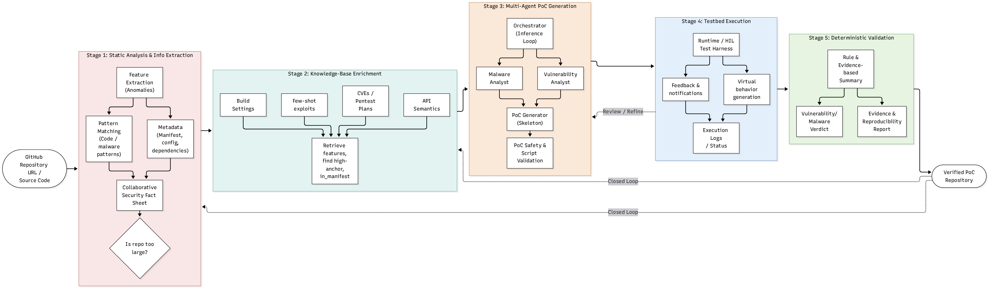

*Lightweight view the five stages and what flows between them:*

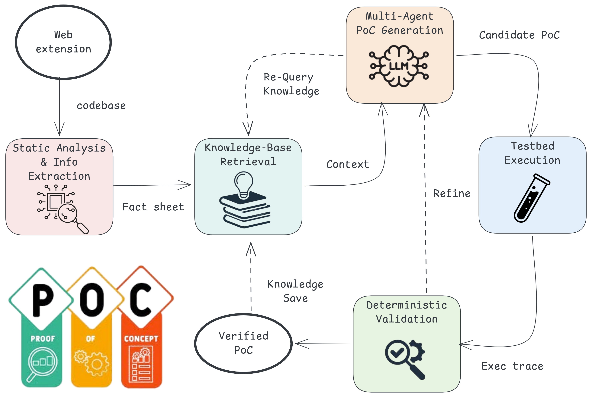

## Why

Static detectors flag *candidate* vulnerable flows but cannot tell you whether an attacker can *actually* trigger them. LLMs can draft exploit PoCs but hallucinate confirmations. ExtPoCGen couples the two and puts a **differential oracle** in charge of the verdict: an exploit is **CONFIRMED only if the dangerous sink fires with an attacker-controlled value AND does not fire without the attacker**. Nothing else concludes.

## How it works (pipeline)

1. **Static detection**: DoubleX (×2 passes) + CoCo taint → candidate `source → sink` flows.
2. **Fact sheet**: attacker entry model (A = malicious web page, B = another extension), candidate findings, 3-state triage (`has-candidate` / `clean` / `incomplete-analysis`).
3. **PoC generation**: an LLM (DeepSeek) drafts an attacker page from a **handler contract** (exact channel, guards and tainted field) extracted from the code.
4. **Differential oracle**: the extension is loaded in an **isolated, instrumented headless Chrome** (CDP, `--load-extension`), served a local attacker page with a **canary**; the sink is observed with and without the attacker. `attacker_controlled = fired_with AND not fired_without`.
5. **GOD agent**: a symbolic, reco-gated meta-diagnostic that reads run traces and classifies *why* a run did not confirm (threat-model boundary vs generator deficiency vs oracle-coverage gap), without ever touching the oracle.

Architecture diagrams: [`MyThinking-Archi/`](MyThinking-Archi/).

### Knowledge graph (Graph-RAG store)

Stage 2 retrieves from a typed knowledge graph (`rag/graph/kb.sqlite`, 1393 nodes / 1368 edges):
attack patterns, the exact Chrome APIs, sinks and sources, PoC skeletons, CWE classes and per-extension
evidence, linked by typed edges (`targets_sink`, `CLASSIFIED_AS`, `DECLARES`, ...). From a candidate
sink the agent walks to the matching attack pattern, its canary-based oracle and a few-shot example.

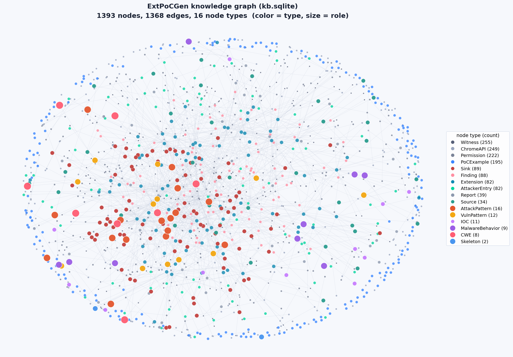

## The tool (dashboard)

`python3 code/server.py` serves an interactive studio (http://localhost:8750) to upload an extension
or run a pre-analysed sample through the full pipeline and watch it live.

**Analyse** drop a packed `.zip`/`.crx` or an unpacked folder (analysed with CoCo/DoubleX and
observed in isolated Chrome), or pick one of the pre-analysed samples:

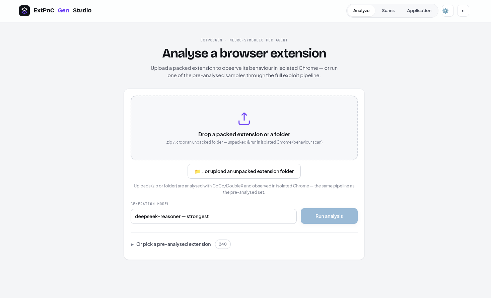

**Live pipeline map and agent-action stream** Stage 1 static detection, Stage 2 Graph-RAG knowledge
base, Stage 3 multi-agent PoC generation, Stage 4 isolated Chrome execution, Stage 5 deterministic
verifier, with per-run elapsed / LLM calls / tokens / cost:

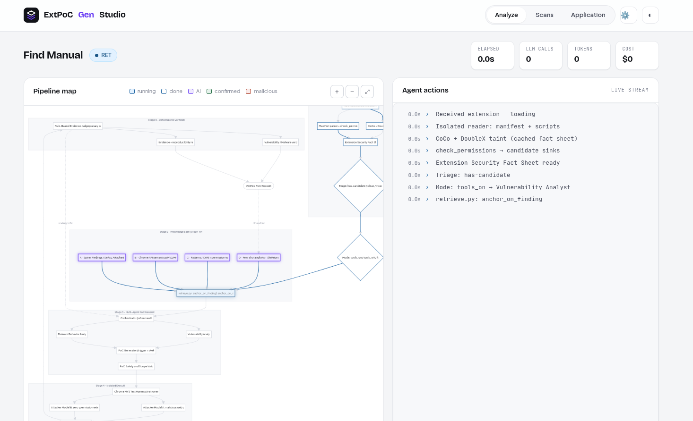

**A confirmed exploit** the dangerous sink, the differential-oracle verdict, and the generated
benign-canary PoC. The canary is observed flowing through the sink in isolated Chrome, which is the
sole basis for a `confirmed` verdict (zero false positives by construction):

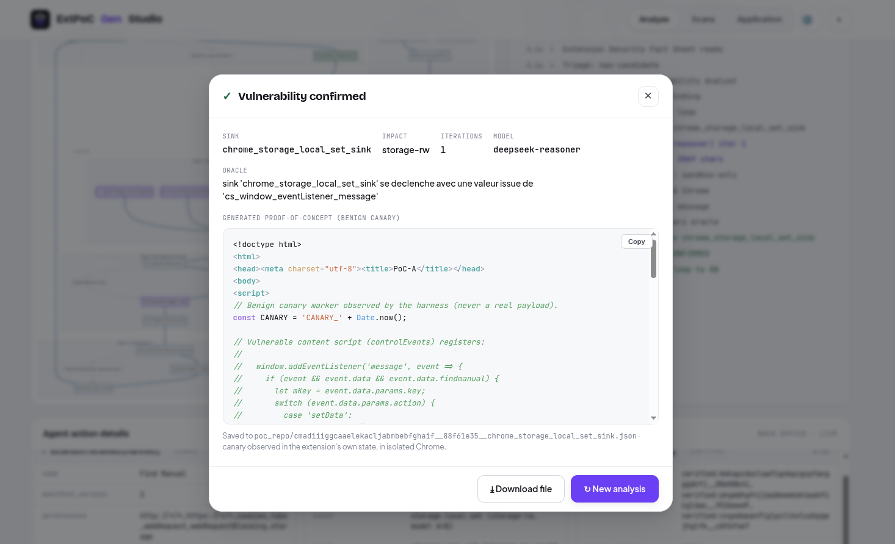

## Results

The oracle confirms **only observed** exploits: **zero false positives by construction**.

### Training / validation set: real vulnerable extensions (min-set)

The architecture (oracle, handler-contract resolver, GOD diagnostics) is built and validated on a
labelled **min-set of 54 real vulnerable browser extensions**:

| Stage | Result |
|---|---|
| **Static detection** (attacker-controlled candidate flow found) | **39 / 54 = 72 %** |
| **Oracle-confirmed PoCs** (working, differentially proven) | **22 extensions** |
| &nbsp;&nbsp;↳ of the flagged candidates | 22 / 39 = **56 %** |
| &nbsp;&nbsp;↳ of the full vulnerable set | 22 / 54 = **41 %** |

Every confirmation is **oracle-grounded** (differential, canary-based): the exploit was *observed*
firing under attacker control and *not* firing without it. No verdict rests on an LLM claim.

The statically-flagged vulnerable extensions, clustered on their own code (manifest content_scripts and
background, vendor libraries excluded so shared libs do not dominate), are structurally diverse, and the
oracle-confirmed exploits (green, right) spread across the space rather than sitting in one cluster.

| Clustered by vulnerability impact category | Colored by detection result (green = confirmed) |
|---|---|
| 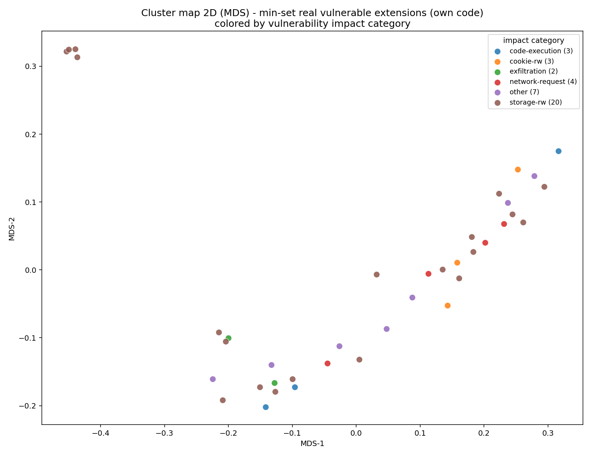 | 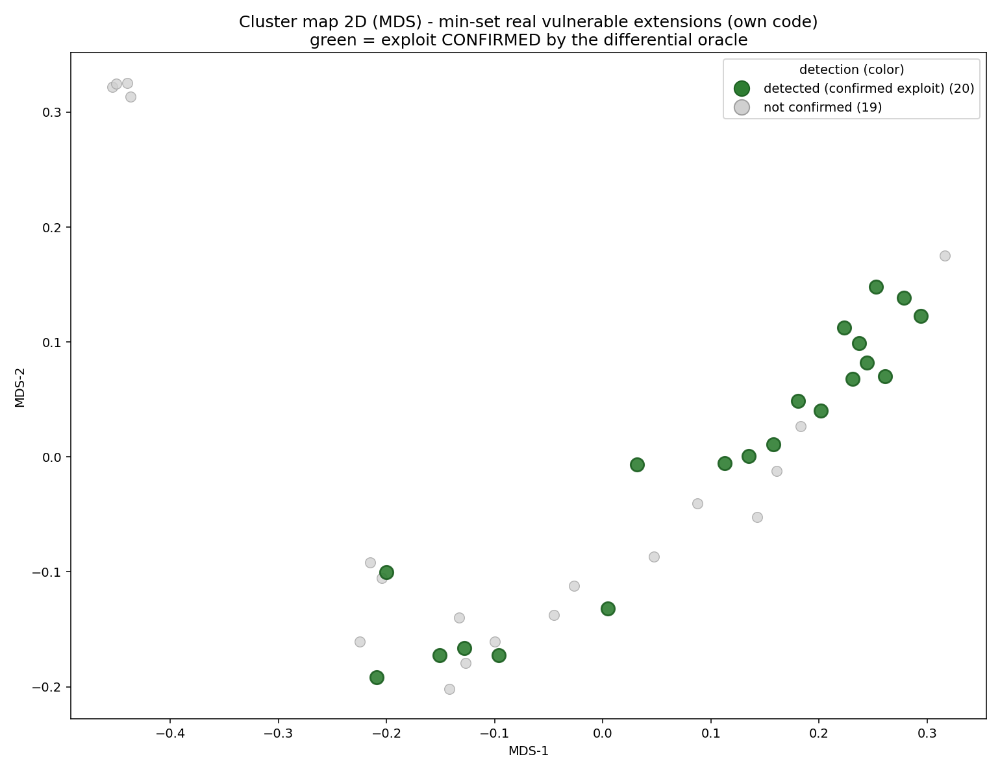 |

### Test set: generated extensions (ChromeSecBench)

To evaluate the pipeline on a held-out set never used for tuning, we synthesise full extensions from
the **[ChromeSecBench](https://github.com/yueyueL/ChromeSecBench) benchmark** (arXiv:2510.16823):
each manifest + description specification is completed into a runnable extension with DeepSeek, then
passed through the same pipeline. Reachability is tiered under the web-attacker model: **A** (an
arbitrary web page can reach the surface) and **A'** (a first-party-locked surface, which the harness
serves in the sandbox by impersonating that origin over TLS, i.e. exploitable if an attacker controls
content on the trusted host). Of 140 specifications, **135 are testable** (62 A + 73 A'); 5 expose no
web surface.

**Protocol.** The headline test is a **held-out set of 101 generated extensions, each run exactly
once** (no re-runs, no best-of-N). A separate set of 30 generated extensions was used *during*
resolver development (seen across several passes) and is **excluded from the held-out rate** to avoid
best-of-N bias; it is reported only in the per-batch progression below. Treating every generated
specification as vulnerable (the ChromeSecBench ground-truth assumption), the confusion matrix on the
**101 held-out extensions** is:

| Metric | Result |
|---|---|
| **TP** (oracle-confirmed exploits) | **60 / 101** |
| **Recall = detection rate** | **59.4 %** |
| &nbsp;&nbsp;↳ tier A (arbitrary page) | 20 / 32 = **62 %** |
| &nbsp;&nbsp;↳ tier A' (first-party, sandboxed origin) | 40 / 69 = **58 %** |
| **FN** (vulnerable, not confirmed) | **41** (miss rate **40.6 %**) |
| **FP** (confirmed in error) | **0** (by construction) |
| **Precision** | **1.000** |
| **F1** | **0.745** |
| Cost | **~$0.014 / run** |

The tiers partition the set exactly: 20 + 40 = 60 confirmations over 32 + 69 = 101 extensions.
The soundness guarantee is **FP = 0 / precision = 1.0** (the differential oracle never confirms a
non-exploit). *Accuracy* and *false-positive rate* are **undefined** here: the generated set has no
benign/negative class (no true negatives), so FPR = FP/(FP+TN) is 0/0. The **41 FN are an upper
bound**: some non-confirmed specs may carry no web-reachable vulnerability at all (true negatives
under the attacker model rather than misses), which only per-extension ground-truth review could
separate.

Detection climbed with the architecture work (development batches: baseline 0 to 10 %, then 40 %,
50 %, then ~58 % once the multi-hop/stateful contract resolver and the A/A' reachability tiering were
in place) and held **stable at ~55 to 73 % across the five held-out batches** (12/20, 11/20, 12/20,
17/30, 8/11), at **zero false positives across every run**. First-party surfaces reached by sandbox
origin-impersonation (A') confirm about as often as arbitrary-page surfaces (A). The remaining
non-confirmations are dominated by generator shape/timing (the PoC not reaching the sink) and a
minority of hard multi-hop/stateful contracts, never by the oracle. Per-run evidence (triage, sinks,
GOD diagnosis) lives in `pipeline_runs_*/`, and the full ledger (one record per run, with metrics) in
`pipeline_runs_tracking/generated_runs_tracking.json`; results are subject to LLM sampling variance,
and every attribution is made per-run from the actual traces.

The 139 generated extensions are structurally diverse (no near-duplicates), and the 76 oracle-confirmed
exploits are scattered across the structural space, not confined to one easy cluster (each point is one
extension by 2D MDS on AST-token distance; green = oracle-confirmed).

| Clustered by vulnerability category | Colored by detection result (green = confirmed) |
|---|---|
| 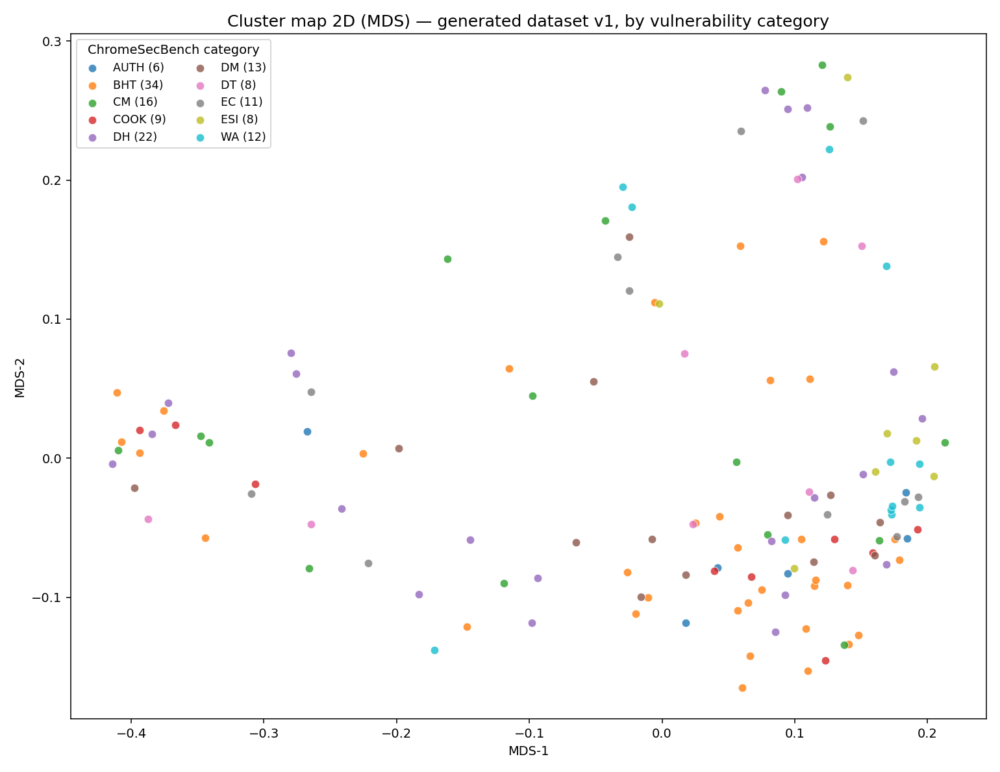 | 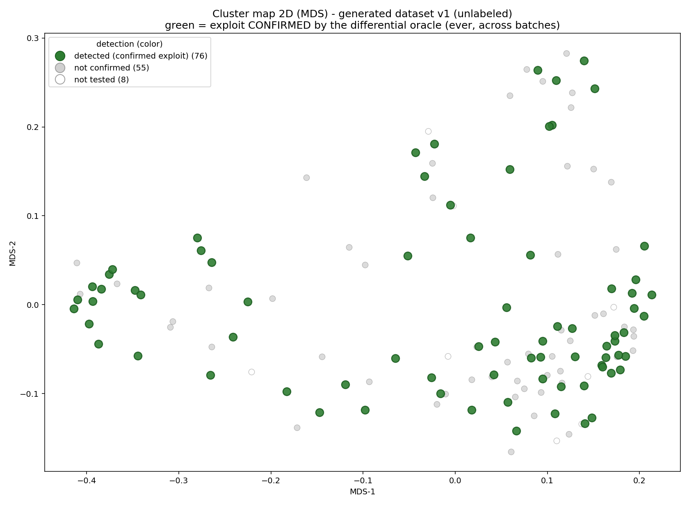 |

### Test set with a negative class: generated vulnerable + benign extensions

The generated set above has no benign/negative class, so *precision*, *FPR* and *accuracy* stay
undefined there. To close that gap we built a second held-out set where **vulnerable and benign
extensions share the exact same manifest** and differ only in the generation prompt (a clean control):
DeepSeek is asked once to introduce the vulnerable flow and once to implement the same feature safely.
This yields **102 vulnerable + 30 benign** loadable extensions, each run once through the same oracle,
with **four generators**: DeepSeek, Qwen3-Coder (480B, via OpenRouter), Claude Haiku 5.5, and a partial
GPT-5-mini.

While running them, the oracle produced a striking finding: **15 of the 30 extensions the LLM had
labelled benign actually fire the dangerous sink under attacker control and not without it** - they are
**differentially proven exploits**. The "secure" generation prompt failed and the benign label is simply
wrong, so we **reclassify those 15 as `vuln` in the dataset** (`publication/datasets/labels.csv`),
bringing the ground truth to **120 vuln / 15 benign / 15 malware** (117 vuln + 15 benign loadable and
tested). In other words **half of the LLM-generated "benign" controls are in fact exploitable** - and
*the more generators we run, the more mislabels surface*: DeepSeek exposes 8, Qwen3-Coder 12, Haiku 2,
and their union is 15.

Against this corrected ground truth (vuln = positive, benign = negative), **every generator keeps
precision 1.000 / FPR 0.000** - the differential oracle never confirms a non-exploit - while **recall
tracks the generator**:

| Generator | Recall (vuln) | Precision | FPR | F1 | Accuracy | Cost (full v2) |
|---|---|---|---|---|---|---|
| **DeepSeek** | 67 / 117 = **57.3 %** | 1.000 | 0.000 | 0.728 | 62.1 % | ~$2 |
| **Qwen3-Coder** (480B) | 65 / 117 = **55.6 %** | 1.000 | 0.000 | 0.714 | 60.6 % | ~$2.2 |
| **Claude Haiku 5.5** | 36 / 117 = **30.8 %** | 1.000 | 0.000 | 0.471 | 38.6 % | ~$1.25 |
| GPT-5-mini *(partial, 52 ext)* | ≈ 17 % | 1.000 | 0.000 | - | - | ~$4 |

Confusion matrices of the two strongest generators (vuln = positive, benign = negative):

*DeepSeek*
| | predicted vuln (confirmed) | predicted non-vuln |
|---|---|---|
| **vuln (actual, 117)** | TP = 67 | FN = 50 |
| **benign (actual, 15)** | FP = 0 | TN = 15 |

*Qwen3-Coder*
| | predicted vuln (confirmed) | predicted non-vuln |
|---|---|---|
| **vuln (actual, 117)** | TP = 65 | FN = 52 |
| **benign (actual, 15)** | FP = 0 | TN = 15 |

Both read **recall 57.3 % / 55.6 %, precision 1.000, FPR 0.000** - identical soundness, generator-dependent recall.

**Two takeaways.** First, **soundness is a property of the validator, not the generator**: swapping the
model that writes the exploits moves recall across a ~3.5× range (≈17 % → 57 %) but never yields a false
positive (precision 1.000, FPR 0 everywhere). Second, **the two strongest generators are complementary** -
of the 117 true vulnerabilities, Qwen3-Coder confirms **16 that DeepSeek misses** (and DeepSeek confirms
18 that Qwen misses), so the **union of DeepSeek + Qwen3-Coder reaches 67 + 16 = 83 / 117 = 70.9 % recall,
+13.6 points over DeepSeek alone**, still at precision 1.000. More generators means more recall *and* more mislabels uncovered, soundness unchanged.

Because every confirmation is a proven exploit, the **union of several generators** raises effective
recall for free, with **precision pinned at 1.000** throughout:

| Configuration | Recall | F1 | Accuracy | Cost | Time |
|---|---|---|---|---|---|
| DeepSeek alone | 67 / 117 = **57.3 %** | 0.728 | 62.1 % | ~$2 | ~8.9 h |
| DeepSeek + Qwen3-Coder | 83 / 117 = **70.9 %** | 0.830 | 74.2 % | ~$4.2 | ~15.6 h |
| **DeepSeek + Qwen3-Coder + Haiku** | 85 / 117 = **72.6 %** | **0.842** | **75.8 %** | ~$5.5 | ~20.1 h |

Cost and time are cumulative (one more generator = one more full run). The runs are independent, so in
parallel the wall-clock collapses to the slowest one (~9 h). Since precision is pinned at 1.000, every
point of recall is a point of F1: the three-generator ensemble lifts the system from F1 0.728 to **0.842**
without a single false positive.

The reclassification rests entirely on the oracle's soundness - each reclassified extension carries
`attacker_controlled = True` in its trace - so it adds no unproven assumption. Per-run evidence is in
`pipeline_runs_v2_labeled/` (DeepSeek), `pipeline_runs_v2_qwen/` (Qwen3-Coder) and
`pipeline_runs_v2_claude/` (Haiku); the eval summary is in `publication/metrics/v2_eval.json` and the
matrices in `publication/tables/confusion_matrix.md`.

**Cost and time per generator.** Per confirmed detection (the metric that matters), DeepSeek is the
cheapest (~$0.029 / exploit) and Qwen3-Coder the fastest (~6.3 min / exploit); Haiku is cheapest and
fastest *per extension* (~$0.009, ~2 min) but confirms fewer, so its per-detection cost lands similar.
Budget 4, same oracle; GPT-5-mini is excluded (partial run).

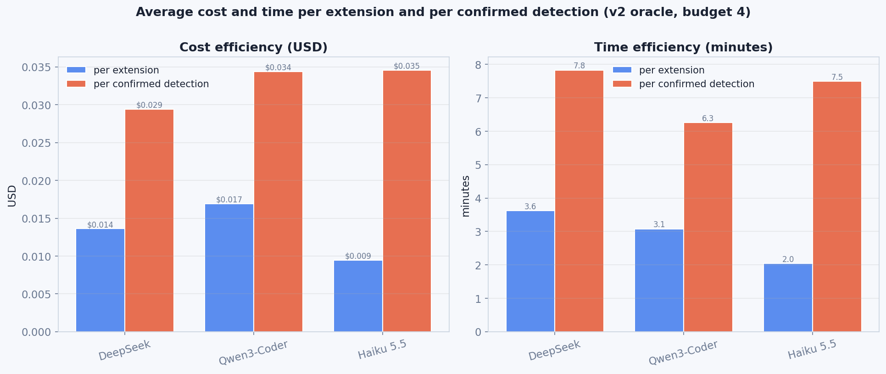

**Recall by family.** Broken down by vulnerability family, the generators are visibly complementary:
DeepSeek leads on BHT and CM, Qwen3-Coder leads on AUTH and COOK, they tie on DH / DM / DT, and Haiku
trails across the board. This is why their union lifts recall so much (70.9 % for DeepSeek + Qwen3-Coder).

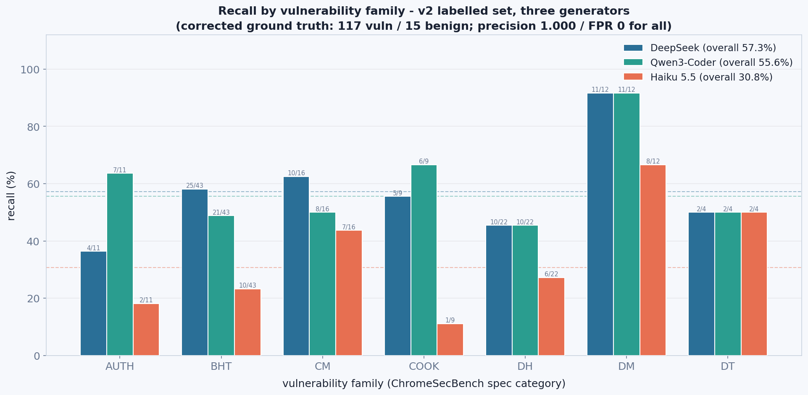

Structurally, the 150 labelled extensions (vuln + benign, malware shown) are diverse and the confirmed
exploits spread across the whole space, not one easy cluster. Each point is one extension (2D MDS on
AST-token distance); shape = class (circle vuln, square benign, triangle malware), green = confirmed.
The confirmed benign squares are proven mislabels (DeepSeek's 8 are shown here; 15 across all
generators); malware triangles are shown for completeness (behaviour path confirms only 1 of 15).

| Clustered by class | Colored by detection result (green = confirmed) |
|---|---|
| 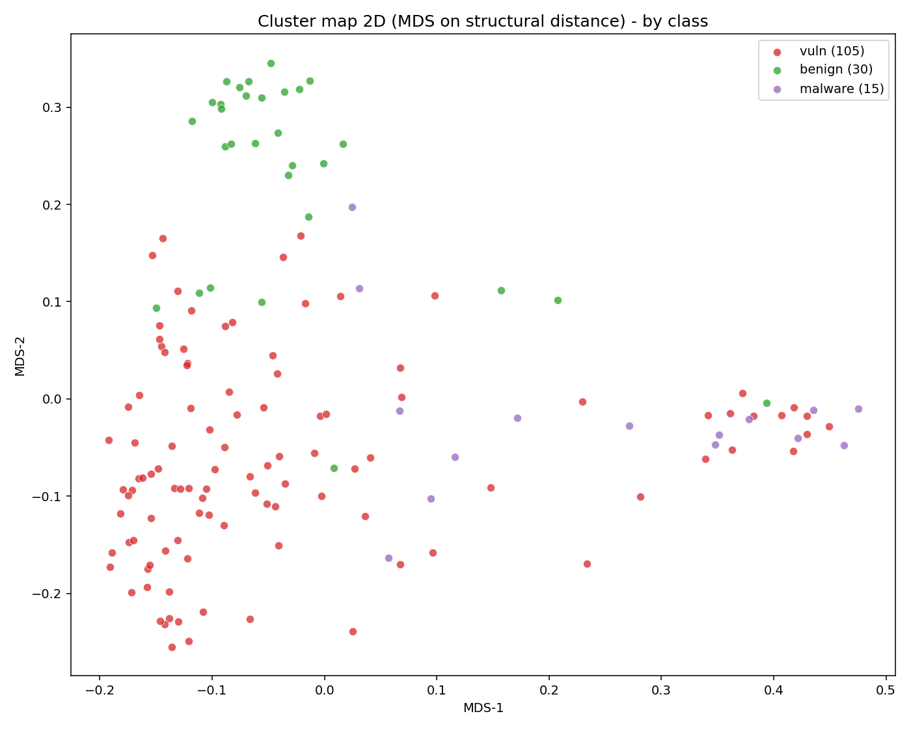 | 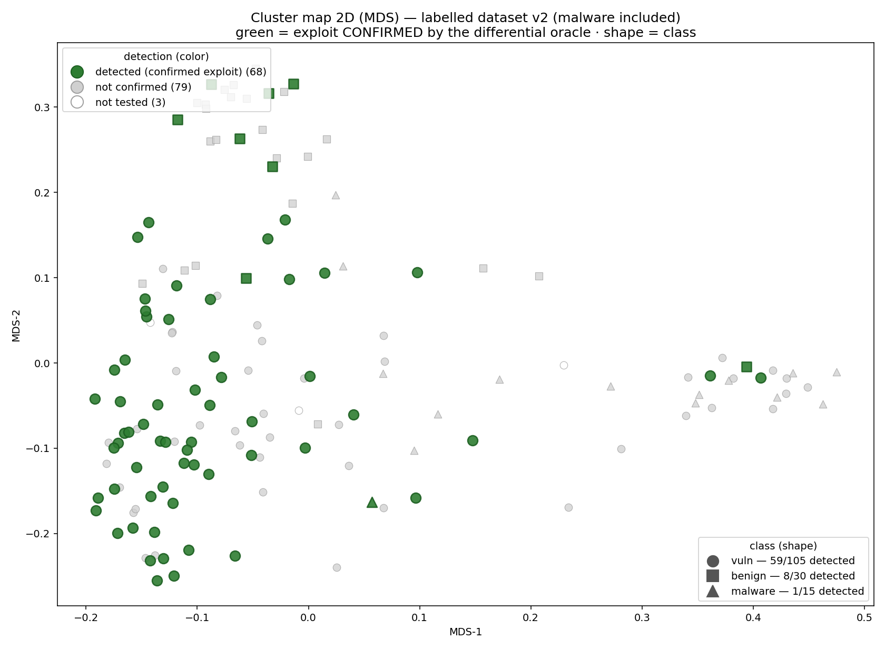 |

## Repository layout (what is included here)

| Path | Contents |
|---|---|
| [`code/`](code/) | Implementation: `orchestrator.py`, `harness.py` (CDP oracle), `god_agent.py`, `build_fact_sheets.py`, `server.py` + `dashboard.html`, `eval_*.py` |
| [`rag/`](rag/) | Knowledge base: attack KB + PoC skeletons |
| `pipeline_runs_*/` | Experimental **results** (per-extension reports + funnel) for the generated batches |
| [`min-set/`](min-set/) | Dataset **index + builder only** (`index.csv`, `build_minset.py`); **no payloads** |
| [`MyThinking-Archi/`](MyThinking-Archi/) | Architecture docs and diagrams |

## Not included (and why)

- **Real malware** and third-party extension payloads (`min-set/malware|vulnerable|unlabel/`, `vuln-set/`): **not redistributed** for safety and copyright. Only the dataset **index + builder** ship here.
- **Working exploit PoCs** (`poc_repo/`): withheld (responsible disclosure).
- **Third-party tools** are **not vendored**. Clone them yourself:
  - DoubleX: <https://github.com/Aurore54F/DoubleX> → `DoubleX/`
  - CoCo: <https://github.com/CoCoAbstractInterpretation/CoCo> → `CoCo/`
- Chromium binaries, Python/Node environments, caches, large derived outputs, and `.env`.

## Setup

```bash
# 1. Python deps for the static analysers (DoubleX/CoCo)
python3 -m venv .static_venv && . .static_venv/bin/activate
pip install func_timeout networkx "sty==1.0.0rc0" tqdm flask jsbeautifier beautifulsoup4 graphviz

# 2. Third-party detectors
git clone https://github.com/Aurore54F/DoubleX.git DoubleX
git clone https://github.com/CoCoAbstractInterpretation/CoCo.git CoCo

# 3. LLM key
cp .env.example .env     # then set Deepseek_API_KEY

# 4. Headless Chromium available on PATH (for the oracle)
```

## Running

```bash
# One extension through the full pipeline (static, PoC, differential oracle)
python3 code/orchestrator.py <ext_id> --agent deepseek --harness cdp \
        --budget 12 --model deepseek-reasoner

# Interactive dashboard (upload an extension / browse pre-analysed set), http://localhost:8750
python3 code/server.py
```

## Safety & ethics

This repository studies **real** malicious and vulnerable extensions. We **do not** redistribute malware or working exploits. Any malware must be executed **only in network/process isolation** (e.g. `unshare -rn`); never load it in a normal browser. The oracle instruments a disposable, isolated Chrome profile.

## Status

**Study in progress.** Research prototype under active development. Two core modules
(`code/orchestrator.py`, `code/harness.py`) are withheld from this public snapshot and
are available on request: `gnintezemo.m.rosly@aims-senegal.org`. No license is set yet
(all rights reserved by default); a license will be added before any third-party reuse.
