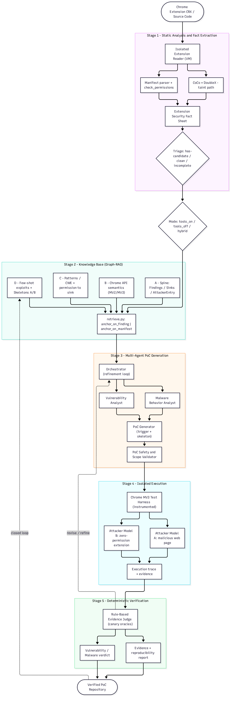

# ExtPoCGen: Sound Proof-of-Concept Generation for Browser-Extension Vulnerabilities and Malicious Behaviors

> *Neuro-symbolic agent that **generates** and, above all, **soundly validates** Proof-of-Concept (PoC) exploits for browser-extension vulnerabilities, plus a malicious-behaviour detection path. A verdict is only ever reached from **observed, deterministic proof**: zero false positives by construction.*

---

**Status: study in progress.** Two core modules (`code/orchestrator.py`, the agent, routing and handler-contract resolver; and `code/harness.py`, the differential oracle) are **withheld** from this public snapshot and are **available on request**: `gnintezemo.m.rosly@aims-senegal.org`.



## Why

Static detectors flag *candidate* vulnerable flows but cannot tell you whether an attacker can *actually* trigger them. LLMs can draft exploit PoCs but hallucinate confirmations. ExtPoCGen couples the two and puts a **differential oracle** in charge of the verdict: an exploit is **CONFIRMED only if the dangerous sink fires with an attacker-controlled value AND does not fire without the attacker**. Nothing else concludes.

## How it works (pipeline)

1. **Static detection**: DoubleX (×2 passes) + CoCo taint → candidate `source → sink` flows.
2. **Fact sheet**: attacker entry model (A = malicious web page, B = another extension), candidate findings, 3-state triage (`has-candidate` / `clean` / `incomplete-analysis`).
3. **PoC generation**: an LLM (DeepSeek) drafts an attacker page from a **handler contract** (exact channel, guards and tainted field) extracted from the code.
4. **Differential oracle**: the extension is loaded in an **isolated, instrumented headless Chrome** (CDP, `--load-extension`), served a local attacker page with a **canary**; the sink is observed with and without the attacker. `attacker_controlled = fired_with AND not fired_without`.
5. **Malicious-behaviour path**: for extensions with no vulnerability surface, behaviour is observed in isolated Chrome (canary + sinkhole) and scored.
6. **GOD agent**: a symbolic, reco-gated meta-diagnostic that reads run traces and classifies *why* a run did not confirm (threat-model boundary vs generator deficiency vs oracle-coverage gap), without ever touching the oracle.

Architecture diagrams: [`MyThinking-Archi/`](MyThinking-Archi/).

## Results

The oracle confirms **only observed** exploits: **zero false positives by construction**.

### Real vulnerable extensions (min-set)

On the labelled min-set of **54 real vulnerable browser extensions**:

| Stage | Result |
|---|---|
| **Static detection** (attacker-controlled candidate flow found) | **39 / 54 = 72 %** |
| **Oracle-confirmed PoCs** (working, differentially proven) | **22 extensions** |
| &nbsp;&nbsp;↳ of the flagged candidates | 22 / 39 = **56 %** |
| &nbsp;&nbsp;↳ of the full vulnerable set | 22 / 54 = **41 %** |

Every one of the 22 confirmations is **oracle-grounded** (differential, canary-based): the exploit was *observed* firing under attacker control and *not* firing without it. No verdict rests on an LLM claim.

### Generated extensions (ChromeSecBench)

To stress-test the generator at scale, we synthesise full extensions from the
**[ChromeSecBench](https://github.com/yueyueL/ChromeSecBench) benchmark** (arXiv:2510.16823):
its manifest + description specifications are completed into runnable extensions with DeepSeek,
then passed through the same pipeline. On these generated, web-reachable extensions the
confirmation rate is governed by the static→generator **handler-contract binding** (channel and
guards), not by the oracle:

| Batch (10 generated extensions each) | Confirmed PoCs |
|---|---|
| random selection | 1 / 10 |
| reachability-filtered, baseline contract resolver | 0 / 10 |
| reachability-filtered, **improved contract resolver** | **4 / 10** |

Improving how the triggering channel and guards are bound to each sink moves the generator from
0 to 4 confirmations on comparable extensions, while the oracle keeps the false-positive rate at
zero. Per-run evidence (prompts, generated PoCs, oracle traces, GOD diagnosis) lives in
`pipeline_runs_*/`; results are also subject to LLM sampling variance, and every attribution in the
reports is made per-run from the actual traces.

## Repository layout (what is included here)

| Path | Contents |
|---|---|
| [`code/`](code/) | Implementation: `orchestrator.py`, `harness.py` (CDP oracle), `god_agent.py`, `build_fact_sheets.py`, `server.py` + `dashboard.html`, `eval_*.py` |
| [`rag/`](rag/) | Knowledge base: attack KB + PoC skeletons |
| `pipeline_runs_*/` | Experimental **results** (per-extension reports + funnel) for the generated batches |
| `behavior_repo/` | Malicious-behaviour analysis reports (IOCs, outbound attempts) |
| [`min-set/`](min-set/) | Dataset **index + builder only** (`index.csv`, `build_minset.py`); **no payloads** |
| [`MyThinking-Archi/`](MyThinking-Archi/) | Architecture docs and diagrams |

## Not included (and why)

- **Real malware** and third-party extension payloads (`min-set/malware|vulnerable|unlabel/`, `vuln-set/`): **not redistributed** for safety and copyright. Only the dataset **index + builder** ship here.
- **Working exploit PoCs** (`poc_repo/`): withheld (responsible disclosure).
- **Third-party tools** are **not vendored**. Clone them yourself:
  - DoubleX: <https://github.com/Aurore54F/DoubleX> → `DoubleX/`
  - CoCo: <https://github.com/CoCoAbstractInterpretation/CoCo> → `CoCo/`
- Chromium binaries, Python/Node environments, caches, large derived outputs, and `.env`.

## Setup

```bash
# 1. Python deps for the static analysers (DoubleX/CoCo)
python3 -m venv .static_venv && . .static_venv/bin/activate
pip install func_timeout networkx "sty==1.0.0rc0" tqdm flask jsbeautifier beautifulsoup4 graphviz

# 2. Third-party detectors
git clone https://github.com/Aurore54F/DoubleX.git DoubleX
git clone https://github.com/CoCoAbstractInterpretation/CoCo.git CoCo

# 3. LLM key
cp .env.example .env     # then set Deepseek_API_KEY

# 4. Headless Chromium available on PATH (for the oracle)
```

## Running

```bash
# One extension through the full pipeline (static, PoC, differential oracle)
python3 code/orchestrator.py <ext_id> --agent deepseek --harness cdp \
        --budget 12 --model deepseek-reasoner

# Interactive dashboard (upload an extension / browse pre-analysed set), http://localhost:8750
python3 code/server.py
```

## Safety & ethics

This repository studies **real** malicious and vulnerable extensions. We **do not** redistribute malware or working exploits. Any malware must be executed **only in network/process isolation** (e.g. `unshare -rn`); never load it in a normal browser. The oracle instruments a disposable, isolated Chrome profile.

## Status

**Study in progress.** Research prototype under active development. Two core modules
(`code/orchestrator.py`, `code/harness.py`) are withheld from this public snapshot and
are available on request: `gnintezemo.m.rosly@aims-senegal.org`. No license is set yet
(all rights reserved by default); a license will be added before any third-party reuse.
